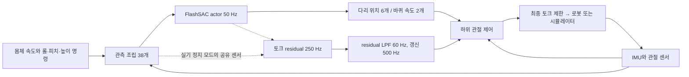

# TITA 평지 주행과 자세 제어 시스템 기술 자료

TITA는 **50 Hz FlashSAC 정책**으로 몸체 속도와 자세 명령을 다리 관절 위치 목표 6개와 바퀴 회전 속도 목표 2개로 변환한다. 하위 제어기가 센서 피드백으로 목표를 토크로 바꾼다. `flat_roll_pitch_height`는 이 구조로 전진·후진·곡선·제자리 회전과 롤·피치·높이 추종을 함께 학습한다.

2026-11-24 기준 `agent/codex/straight-heading` 작업 폴더의 체크포인트와 실행 코드를 읽어 정리했다. 실행 도메인은 `DESKTOP_DRY_RUN`이다. 표의 주기는 코드와 저장 계약의 설정값이다. 주행 성능 수치는 앞서 완료한 `VALIDATION_SIM`에서 가져왔다.

| 적용 범위 | 정책 | 증거 |
| --- | --- | --- |
| 이번 평지 주행 실험 | `flat_roll_pitch_height/model_85000`, actor 38 → 8 | Actor SHA256 `011c043642752e3e4adc51f8d401d9dbbce8a9d2d98948f813358fde6eb893a5`. Native mjlab 및 sim2sim 검증 `PASS`, 이 체크포인트의 실기 성능 `NOT_TESTED`. |
| 저장소의 실기 기본 설정 | 별도로 학습한 `Teacher80k`, actor 38 → 8 | Actor SHA256 `5487e3584fddbdfc87b7485bb2ad4c7da8069a7679b1975789d64419e7482334`. 저장된 정책 선택과 실행 계약을 기준으로 기술한다. |
| 실기 선택 모드 | `Teacher80k` + 정지 자세용 LPF60 torque residual, residual actor 440 → 8 | Residual SHA256 `d6672529ee247a92b7043f50bb6deb501a65becbf760761a412b33d5701b6002`. ONNX 내보내기 검증 `PASS`. |

[85000 내보내기 및 재생 기록](../2026-11-20/sim2sim_heading_baseline_summary.md) · [실기 정책 선택](../../../sim2real/config/policies.json) · [실기 실행 계약](../../../sim2real/tita_ws/README.md)

## 1. 데이터 흐름과 제어 주파수



| 실행 경로 | 정책 갱신 | 하위 제어·물리 갱신 | 한 정책 스텝 동안 |
| --- | --- | --- | --- |
| Native mjlab 학습과 평가 | 50 Hz, 20 ms | 물리·PD 200 Hz, 5 ms | 목표를 4개 물리 스텝에 걸쳐 사용하며 각 스텝에서 PD를 계산한다. |
| 기본 ROS 2 sim2sim, `model_85000` | 50 Hz, 20 ms | MuJoCo·PD 200 Hz, 5 ms | ROS 타이머에서 ONNX를 평가하고, 각 물리 스텝의 관절 상태로 토크를 다시 계산한다. |
| 실기 Teacher 단독 | 50 Hz, 20 ms | SBC 모터 제어·통신 목표 500 Hz, 2 ms | 정책 목표를 유지하는 동안 모터 루프 10회에서 관절 피드백을 사용한다. |
| 실기 Teacher + residual | Teacher 50 Hz, residual 250 Hz, 4 ms | 모터 루프와 residual 필터 갱신 500 Hz, 2 ms | 정책 워커의 결과를 모터 루프가 비동기로 받아 유지한다. Residual LPF의 차단 주파수는 60 Hz다. |

LPF60 전용 sim2sim도 50/250/500 Hz 구성을 사용한다. 기본 sim2sim과 LPF60 실행기의 물리 시간 간격이 다르므로 residual 효과를 비교할 때는 같은 실행기에서 residual 활성 상태를 바꾼다. 실기 모터 루프의 500 Hz는 제어·로깅 주기다. 센서 수신 주기와 모터가 실제로 토크를 인가한 시점은 별도 계측 대상이다. [Native 환경](../../../mj_lab/robots/tita/flat_env_cfg.py#L101) · [sim2sim 제어 루프](../../../sim2sim/sim2sim_ros2_jazzy/sim2sim_ros2_jazzy/sim2sim_node.py#L240) · [LPF60 실행 계약](../../lpf60_residual.md) · [실기 ROS 제어기](../../../sim2real/tita_ws/README.md)

## 2. 정책 입력과 센서

아래 인덱스는 0부터 시작한다. 실제 `vx`, `vy`, yaw rate는 몸체 좌표계로 정의한다. 높이 명령은 평지 바닥에 대한 `base_link`의 높이를 뜻한다. Actor는 매 시점의 38개 벡터를 받는다. 바퀴 변위와 정지 헤딩 적분, 직전 액션이 과거 정보를 전달한다.

| Actor 인덱스 | 차원 | 관측 | 입력 배율과 처리 |
| --- | ---: | --- | --- |
| 0–2 | 3 | 몸체 각속도 `ωx, ωy, ωz` | 0.25. 실기에서는 IMU gyro를 사용한다. |
| 3–5 | 3 | 몸체 방향으로 투영한 중력 단위 벡터 | 1.0. IMU 자세에서 계산하며 차체 기울기 정보를 준다. |
| 6–8 | 3 | 몸체 속도 명령 `vx, vy, ωz` | `[2, 2, 0.25]`. 이 작업에서 `vy` 명령은 0이다. |
| 9–16 | 8 | 기본 자세에 대한 관절 각도 차 | 1.0. 바퀴 관절의 두 위치 채널은 센서 관측 생성 단계에서 0으로 둔다. |
| 17–24 | 8 | 기본 속도에 대한 관절 각속도 차 | 0.05. 바퀴 각속도 2개를 포함한다. |
| 25–32 | 8 | 직전 정책 액션 | 1.0. 학습 시 gain 적용 후의 값이며, sim2sim에서는 같은 의미의 ONNX 원시 출력이다. 관절 위치·속도 단위로 변환하기 전 값이다. |
| 33 | 1 | 정지 기준에 대한 바퀴 전진 변위 | 5.0. 바퀴와 다리 관절 각도, 차체 피치로부터 구하며 반경 0.0925 m를 사용한다. 변위는 ±0.30 m 범위로 제한한다. |
| 34 | 1 | 정지 명령 중 `ωz` 적분 | 2.0. 적분값을 ±0.5 rad로 제한한다. |
| 35–37 | 3 | 롤·피치·높이 명령 | 각 1.0. 단위는 rad, rad, m이며 변화율 제한을 적용한 목표가 들어간다. |

관절 위치·속도 **관측 순서**는 `L1 R1 L2 R2 L3 R3 L4 R4`다. 직전 액션과 **정책 출력 순서**는 `L1 L2 L3 L4 R1 R2 R3 R4`다. `L4/R4`가 바퀴다. 실행기의 어댑터는 관절 이름으로 모터 순서에 맞춘다. [관측 생성과 정지 상태](../../../mj_lab/robots/tita/common/mdp.py#L159) · [관측 배율](../../../mj_lab/robots/tita/flat_env_cfg.py#L30) · [관절 순서](../../../mj_lab/robots/tita/common/robot_cfg.py#L10) · [sim2sim 관측 어댑터](../../../sim2sim/sim2sim_ros2_jazzy/sim2sim_ros2_jazzy/adapter.py#L160)

**Critic은 학습에서만 쓰는 42개 관측**을 받는다. 앞에 몸체 선속도 3개를 추가하고, 정지 기준에 대한 시뮬레이터의 실제 yaw 편차 1개를 바퀴 변위와 적분 헤딩 사이에 넣는다. Actor에 주입하는 관측 잡음과 gyro·중력·관절 편향은 critic의 대응 채널에서 제외된다. 차체 실제 선속도와 측정 높이는 actor 관측 벡터에 직접 들어가지 않는다. 실제 높이는 학습 보상에서 사용하고, 자세 명령과 관절·중력 상태로부터 필요한 제어 동작을 학습한다. 실기 코드는 바퀴 운동학 기반 선속도 추정치를 정지 기준 판정에도 사용한다. [Actor·critic 관측](../../../mj_lab/robots/tita/flat_env_cfg.py#L30) · [실기 상태와 관측 계산](../../../sim2real/tita_ws/src/tita_controller/src/tita_node.cpp#L693)

정지 기준을 판단하는 명령 범위는 `|vx_cmd|, |vy_cmd| ≤ 0.02 m/s`, `|ωz_cmd| ≤ 0.03 rad/s`다. 바퀴 변위는 차체 평면 속력 <0.10 m/s와 |yaw rate| <0.15 rad/s로 안정된 뒤 누적한다. 주행 중에는 yaw rate 명령을 추종하며, 일반적인 순수 전진·후진에서 주행 시작 방위각이나 경로 횡이탈을 추종하는 항은 없다. [정지 기준과 보상](../../../mj_lab/robots/tita/common/mdp.py#L361)

## 3. 관절 제어와 토크 변환

재생 시 actor는 `a = tanh(μ(o))`로 정규화된 8개 액션을 계산한다. 액션 gain은 양·음에 대해 동일하며, 한쪽의 4개 액션에 `[2.8, 2.0, 2.8, 6.0]`을 곱한다. ONNX에는 이 gain이 포함된다. 하위 어댑터는 gain 적용값에 위치 또는 속도 스케일과 기준 오프셋을 적용한다.

| 관절 유형 | 정규화 액션 `a`의 최종 목표 | 공칭 Kp / Kd | 관절당 토크 한도 |
| --- | --- | ---: | ---: |
| 양쪽 1번 | `q_des = 0 + 0.70 a` rad | 60 / 1.5 | ±60 N·m |
| 양쪽 2번 | `q_des = 0.8 + 0.50 a` rad | 60 / 1.5 | ±60 N·m |
| 양쪽 3번 | `q_des = −1.5 + 0.70 a` rad | 92 / 2.3 | ±60 N·m |
| 양쪽 4번 바퀴 | `dq_des = clip(120 a, −100, +100)` rad/s | 0 / 0.5 | ±12 N·m |

- 다리 토크는 `Kp × (q_des − q) − Kd × dq`로 계산한다. 다리 목표 각속도는 0이다.
- 바퀴 토크는 `Kd × (dq_des − dq)`로 계산한다.
- 최종 토크에는 관절별 포화를 적용한다. 토크 residual 모드에서는 기본 PD 토크와 필터된 residual을 합한 뒤 동일한 최종 포화를 적용한다.

위 수치는 저장된 명목 설정이다. 학습 중에는 게인과 목표 전달 지연을 랜덤화한다. `model_85000` sim2sim과 저장된 실기 Teacher 번들의 다리 액션 필터 설정은 `none`이다. [학습 액션 gain](../../../mj_lab/flash_sac.py#L40) · [ONNX 출력 정의](../../../isaac_lab/ddt_lab/scripts/flash_sac/export.py#L14) · [시뮬레이터 PD](../../../sim2sim/sim2sim_ros2_jazzy/sim2sim_ros2_jazzy/adapter.py#L254) · [실기 토크 어댑터](../../../sim2real/tita_ws/src/tita_controller/include/tita_controller/adapter.hpp#L258)

## 4. FlashSAC와 학습 절차

FlashSAC은 경험 리플레이를 사용하는 **off-policy actor–critic**이다. Actor는 관측에서 가우시안 평균·표준편차를 계산한다. 학습 수집 시 `tanh(μ + σ ε)`로 탐색하며, 잘린 zeta 분포로 뽑은 스텝 수 동안 가우시안 잡음 `ε`를 재사용한다. Actor는 정규화된 선형층, 배치 정규화, ReLU, 잔차 연결, RMS 정규화로 구성된다. ONNX 재생은 평가 모드에서 평균의 tanh를 사용한다.

Critic 두 개는 관측과 액션을 입력받아 반환값 분포를 추정한다. 각 critic은 `[−5, +5]`에 101개 범주를 사용한다. 타깃 쌍 중 기대 Q가 더 작은 critic의 분포에 엔트로피 항과 n-step 보상을 반영해 목표 분포를 만들고, cross-entropy로 학습한다. Actor는 예상 가치와 엔트로피를 함께 최적화하고 엔트로피 온도도 학습한다. 타깃 critic에는 EMA를 적용한다. [FlashSAC 네트워크](../../../isaac_lab/ddt_lab/scripts/flash_sac/vendor/flash_rl/agents/flashSAC/network.py) · [탐색과 리플레이](../../../isaac_lab/ddt_lab/scripts/flash_sac/vendor/flash_rl/agents/flashSAC/agent.py#L429) · [Critic 및 온도 업데이트](../../../isaac_lab/ddt_lab/scripts/flash_sac/vendor/flash_rl/agents/flashSAC/update.py#L164)

| 설정 | `model_85000` 원본 학습 |
| --- | --- |
| 실행 환경 | Native mjlab 1.6.0, MuJoCo·MuJoCo Warp 3.11.0, Python 3.12.3, PyTorch 2.9.1+cu128을 사용하는 `~/venvs/tita_mjlab` |
| 병렬 환경과 총 학습 | 4,096개, seed 42, 100,000 벡터 스텝, 199,948 learner 업데이트 |
| 벡터 스텝 의미 | 4,096개 환경에서 각각 20 ms 전이 1개, 전체 실행에서 409,600,000개 환경 전이 수집 |
| 리플레이 | GPU 저장, 용량 1,000,000, 시작 100,000, 배치 2,048 |
| 업데이트 | 리플레이 준비 후 벡터 스텝당 learner 업데이트 2회, actor 주기 learner 업데이트 2회, target EMA 계수 0.01 |
| 모델 크기 | Actor 폭 128 및 잔차 블록 2개, critic별 폭 256 및 잔차 블록 2개 |
| 반환값과 보상 | `gamma=0.99`, `n_step=3`, 직접 합산 구간 60 ms, 이후 bootstrap. learner 보상 정규화 사용, `normalized_G_max=5` |
| 초기 학습률과 탐색 | 초기·최대 `3e−4`, 스케줄 끝 `1.5e−4`, 감쇠 설정 200,000 업데이트. zeta 지수 2, 최대 16스텝 |
| 저장과 기록 | 5,000스텝마다 체크포인트 저장. W&B 온라인 기록, 10,000스텝마다 미리보기 설정 |

리플레이 수집에는 정책 관측 38개와 critic 관측 42개를 함께 저장한다. 학습 종료 조건과 시간 제한을 별도 플래그로 보관한다. n-step 수집은 두 경계에서 다음 에피소드 보상과 섞이지 않게 끊고, critic의 bootstrap은 실제 종료 여부로 마스킹한다. 환경의 보상에는 20 ms를 곱하고, learner가 리플레이를 샘플링할 때 보상 통계로 별도 스케일링한다. [원본 훈련 인자](../../../../tita_gluon_wbc/docs/exp/2026-11-20/tita_mjlab_105342_003783_args.json) · [훈련 완료 기록](../../../../tita_gluon_wbc/docs/exp/2026-11-20/tita_mjlab_105342_003783_result.json) · [85000 학습기 설정](../../../mj_lab/logs/flash_sac/heading_baseline/model_85000/agent.json) · [n-step 계산](../../../isaac_lab/ddt_lab/scripts/flash_sac/vendor/flash_rl/buffers/torch_buffer.py#L105)

사용한 학습 진입점의 핵심 인자는 다음과 같다.

```bash
~/venvs/tita_mjlab/bin/python -m mj_lab.scripts.train \
  --task flat_roll_pitch_height --num_envs 4096 --steps 100000 --seed 42 --headless
```

### 환경과 명령 분포

| 항목 | 원본 학습 설정 |
| --- | --- |
| 환경 | MuJoCo 평지, 구형 바퀴 충돌 반경 0.0925 m, 에피소드 20초. 차체 바닥 접촉 힘 기준 >1에서 종료하고, 무릎 접촉에는 패널티를 부과한다. |
| 속도 명령 | 6–8초마다 재추출. 10% 정확한 정지, 90%에서 `vx ∼ U[−1.5,+1.5] m/s`와 `ωz ∼ U[−3,+3] rad/s`를 독립 추출한다. `vy=0`. 이동 명령 대부분이 선속도와 회전을 함께 가진다. |
| 자세 명령 | 10–12초마다 독립 재추출. 20% 공칭 `(0°, 0°, 0.335 m)`, 80% 롤 ±30°, 피치 ±15°, 높이 0.27–0.42 m 균일 추출. 롤·피치 0.15 rad/s, 높이 0.02 m/s로 목표값을 움직인다. |
| 물리 랜덤화 | 시작 시 접선 마찰 0.2–1.6, 차체 질량 증분 −0.5~+2.0 kg, 차체 COM 축별 ±0.015 m, 관성 배율 0.85–1.15. 리셋 시 게인 배율 약 0.8–1.2와 무릎 추가 공통 배율 0.55–1.0. |
| 외란과 센서 | 리셋 시 초기 자세·속도·관절 상태를 샘플링하고, 10–15초 간격으로 평면 속도 외란을 준다. 모터 목표 지연은 리셋에서 0–4 물리 스텝을 샘플링한다. Actor 측에는 각속도·중력·관절 관측의 바이어스 및 균일 잡음, 정지 적분용 gyro 편향과 바퀴 반경 배율을 적용한다. |

Actor의 균일 관측 잡음 반폭은 배율 적용 전 각속도 0.2 rad/s, 투영 중력 0.05, 관절 위치 0.01 rad, 관절 속도 1.5 rad/s, 바퀴 변위 0.005 m, 헤딩 0.003 rad다. 정지 헤딩 적분용 gyro 편향은 ±0.0014 rad/s, 바퀴 반경 배율은 0.97–1.03이다. [환경과 잡음 설정](../../../mj_lab/robots/tita/flat_env_cfg.py#L30) · [랜덤화 구현](../../../mj_lab/robots/tita/common/mdp.py#L318) · [자세 명령 구현](../../../mj_lab/robots/tita/roll_pitch_height/flat_env_roll_pitch_height_cfg.py#L20)

### 보상 구조

| 목적 | 보상 항과 가중치 |
| --- | --- |
| 평면 선속도 | `exp(−‖[vx,vy]−[vx_cmd,vy_cmd]‖²/σ²)` 세 항을 합산. `σ = 0.50, 0.25, 0.1768 m/s`, 가중치 `2.0, 0.5, 0.5`. |
| Yaw rate | `exp(−(ωz−ωz_cmd)²/0.50²)`, 가중치 `+1.0`. |
| 롤·피치와 높이 | 목표 롤·피치로 만든 투영 중력 벡터와 현재 투영 중력의 XY 제곱 오차 `−5`. 바닥 기준 `base_link` 높이 제곱 오차 `−10`. |
| 정지 유지 | 기준 위치 거리 `d`에 `exp(−8d)`를 가중치 `+1`로, 정확한 0 명령의 기준 yaw 오차 `Δψ`에 `exp(−5·abs(wrap(Δψ)))`를 가중치 `+1`로 적용. 정확한 0 명령 중 바퀴 액션 4제곱 적분의 제곱근에는 `−0.05`. |
| 동작 안정성 | 수직 선속도 제곱 `−2`, 롤·피치 각속도 제곱 `−0.05`, 토크 제곱 `−1e−5`, 관절 가속도 제곱 `−2.5e−7`, 액션 변화량 제곱 `−0.01`, 무릎 접촉 수 `−1`, 1·2번 관절 기본각 절대 편차 `−1 / −0.5`. 관절 좌우 대칭 가중치는 `0`. |

속도·자세 추종과 일부 패널티에는 `clamp(−g_body,z, 0, 0.7)/0.7`의 upright 계수를 곱한다. 높이 보상과 롤·피치 보상은 actor에 전달되는 것과 같은 변화율 제한 자세 목표를 사용한다. [기본 보상 가중치](../../../mj_lab/robots/tita/flat_env_cfg.py#L64) · [속도·정지 보상 식](../../../mj_lab/robots/tita/common/mdp.py#L387) · [자세·높이 보상 식](../../../mj_lab/robots/tita/roll_pitch_height/flat_env_roll_pitch_height_cfg.py#L135)

## 5. Sim2Sim, 실기와 정지 토크 residual

### 정책 내보내기와 sim2sim

`actor.pt`와 저장 환경에서 관측 순서·스케일·클립·행동 매핑, PD 게인·토크 제한 등을 읽어 ONNX와 설정을 만든다. 추론기에는 38개 관측과 8개 액션 계약이 적용된다. `model_85000`의 내보내기 검사는 256개 동일 입력에서 PyTorch와 ONNX 최대 절대 출력 차이 약 `4.05e−6`이었다. 속도 시험은 고정 Twist 명령과 공칭 자세로 평지 마찰 0.8에서 실행했다. 기본 sim2sim 접촉 설정 `impratio=100`과 학습 설정 `1` 모두에서 후보를 재평가한 로그가 있다. [내보내기 및 기준 sim2sim](../2026-11-20/sim2sim_heading_baseline_summary.md) · [접촉 설정 대조 시험](../2026-11-20/speed_tracking_cause_summary.md)

### 하드웨어 제어 경로

ROS 2 C++ 노드는 조이스틱 명령과 TITA SDK의 IMU·관절 위치·각속도를 받아 ONNX 정책을 실행한다. 조이스틱 주행 명령은 데드존과 저장 한도를 적용한 `vx = −axes[2] × 1.5 m/s`와 `ωz = axes[3] × 3 rad/s`다. 오른쪽 스틱은 롤·피치, `axes[5]`는 높이 변경 속도를 지정한다. 속도 입력은 즉시 반영하고 자세 입력에는 저장된 변화율 제한을 적용한다. 제어기는 준비·착석·RL·감쇠와 소프트웨어 정지 상태를 관리하며, SDK CAN-FD 경로로 토크를 보낸다. 조이스틱 timeout은 0.5초다. [실기 제어 경로](../../../sim2real/tita_ws/README.md) · [명령과 watchdog 구현](../../../sim2real/tita_ws/src/tita_controller/src/tita_node.cpp#L494)

실기 로그에는 정책 입력·출력, 계산한 토크, 모터 루프 시각, SDK 피드백을 남긴다. 계산 토크와 전송 성공은 별도 신호다. Real2Sim 미러는 조인트 상태·IMU·선택적 odometry를 ROS에서 구독하고 MuJoCo에서 관절 매핑과 자세를 확인할 수 있다. 기본 미러 주기는 50 Hz이며 진단 토픽을 내보낸다. [실기 캡처 규격](../../../sim2real/tita_ws/README.md) · [Real2Sim 미러 구현](../../../sim2sim/sim2sim_ros2_jazzy/sim2sim_ros2_jazzy/real2sim_node.py#L14)

### 선택 기능인 LPF60 정지 토크 residual

Residual 정책은 정지에서 균형과 자세를 보완하는 **8개 추가 관절 토크**를 요청한다. RL 상태에서 원하는 속도와 적용 속도가 모두 정확히 0이고, 센서와 자세 조건이 유효하며 스위치가 허용일 때 활성화된다. 저장 범위 안에서 롤·피치·높이 명령에 따른 자세 변경은 가능하다. 이동 명령 중 제어는 Teacher를 사용한다.

| Residual 입력 | 프레임당 차원 |
| --- | ---: |
| Teacher와 공유한 gyro와 투영 중력 | 6 |
| 다리 6관절 상대 위치와 전체 8관절 각속도 | 14 |
| 정규화된 Teacher 액션과 직전 요청 residual 토크 | 16 |
| 속도 명령 3개와 공칭값 대비 롤·피치·높이 명령 3개 | 6 |
| 바퀴 변위와 Teacher 헤딩 관측 | 2 |
| 합계 | **44 × 10 프레임 = 440** |

프레임의 첫 시점부터 마지막 시점까지 간격은 36 ms다. 정지 진입에서는 현재 프레임으로 10개를 채우고 이후 시간 순서대로 이동시킨다. 학습 critic은 754개 관측을 사용한다. Residual 출력은 관절당 ±10 N·m 범위이며, 500 Hz에서 residual만 60 Hz 1차 LPF로 처리한 뒤 매 tick의 PD 토크에 더한다. 직전 residual 관측은 필터 전 요청량이다. 저장된 정책 워커의 결과 만료는 Teacher 40 ms, residual 12 ms다. [Residual 관측 빌더](../../../sim2real/tita_ws/src/tita_controller/include/tita_controller/stop_residual.hpp#L116) · [Residual ONNX 계약](../../../sim2real/checkpoints/mjlab/task/base_velocity/height_roll_pitch/20261109/10000_d6672529ee24/residual/manifest.json) · [정책 워커](../../../sim2real/tita_ws/src/tita_controller/include/tita_controller/async_policy.hpp#L157)

**학습**에서는 Teacher80k를 동결하고 residual actor·critic·replay를 새로 초기화했다. 4,096개 환경, 10초 에피소드, 50,000 벡터 스텝 목표 학습에서 10,000스텝 체크포인트를 선택했다. 배치 크기는 8,096이다. 자세 목표 범위는 Teacher와 같고 5–8초마다 다시 뽑았다. 정지 위치 보상에는 고정 기준점을 사용하고, 액션 변화율은 residual 요청 토크 기준으로 계산한다. Teacher의 바퀴 액션 누적 패널티는 가중치 0이다. 물리 랜덤화에 하중·외력 조건을 더했고, 필터·PD 합산·최종 포화 뒤 0–8 ms 토크 지연을 환경별로 샘플링했다. 실기 코드는 합성 지연을 추가하지 않는다. [Residual 학습 기록](../../../sim2sim/checkpoints/mjlab/task/base_velocity/height_roll_pitch/20261109/10000_d6672529ee24/residual.json) · [학습기 설정](../../../mj_lab/config/residual_lpf60_10k.json) · [LPF60 재현 자료](../../lpf60_residual.md)

## 6. 검증 범위와 현재 성능

- **체크포인트 선택** — 5,000스텝 간격으로 저장된 20개를 직진·후진·곡선·제자리 회전에서 각각 16회, 체크포인트당 총 64회 평가했다. `model_85000`은 조기 종료 0회, 정규화 추종 오차 0.06891로 선택됐다. 4개 동작을 붙인 24초 영상에는 목표와 실제 속도가 표시된다. [선택 기준과 결과](../../../../tita_gluon_wbc/docs/exp/2026-11-20/driving_performance_summary.md) · [주행 영상](../../../../tita_gluon_wbc/docs/exp/2026-11-20/driving_performance/driving_performance.mp4)
- **고정 명령 60초** — 10개 조건 중 9개가 선별 기준을 통과했다. +1.2 m/s 전진의 마지막 10초 평균은 +1.1217 m/s였으며, 두 시뮬레이터에서 정책의 바퀴 목표가 목표 차체 속도에 필요한 회전속도보다 낮았다. +1 rad/s 좌회전의 마지막 구간 잔류 `vx`는 기본 sim2sim +0.10075 m/s였고, `impratio=1`에서 +0.00542 m/s였다. [60초 기준 결과](../2026-11-20/sim2sim_speed_tracking_60s_summary.md) · [바퀴·접촉 원인 검증](../2026-11-20/speed_tracking_cause_summary.md)
- **헤딩 유지** — +0.8 m/s 직진 20초에서 yaw rate MAE는 약 0.013 rad/s였고, 방위각은 +14.24°, 시작 직선 기준 횡이탈은 +1.872 m였다. 몸체 속도 추종과 월드 경로 유지는 별도 지표다. [헤딩 기준선](../2026-11-20/sim2sim_heading_baseline_summary.md)
- **추가 학습** — 명령 분포와 속도 보상의 비교에서 일부 후보가 속도 기준을 만족했지만 자세·높이 보존 기준을 넘었다. 에피소드·회전 유지 시간 비교에서도 새 후보 6개가 전체 채택 기준에 미달했다. 이 비교에서 `gamma=0.99`, `n_step=3`을 고정했다. [보상·명령 분포 실험](../2026-11-23/speed_tracking_improvement_report.md) · [에피소드·명령 지속 시간 실험](../2026-11-23/speed_duration/results.md)

성능 수치는 명시한 시뮬레이션 조건과 체크포인트에 해당한다. 실기 저장 번들의 명령 범위는 제어 입력 범위이며, `model_85000`의 실기 추종·토크·안정성은 `NOT_TESTED`다.
